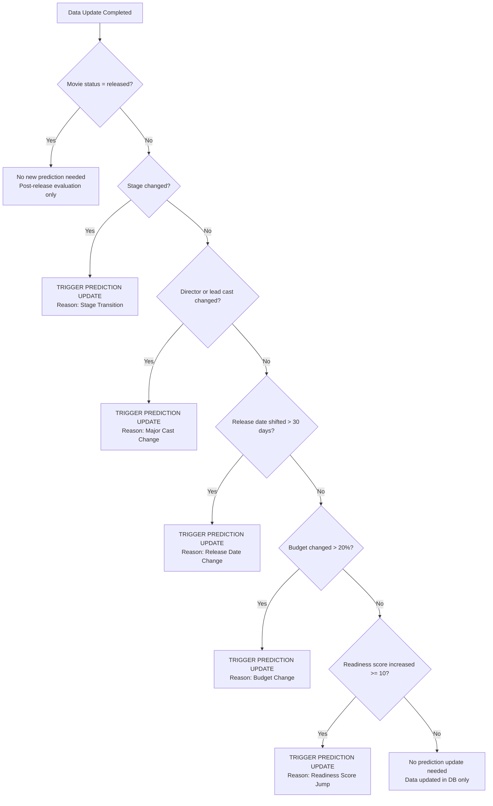
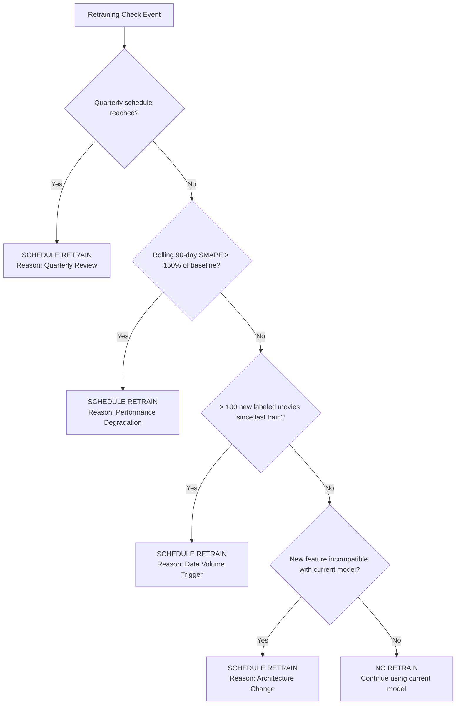

# CineMetrics — Data Update and Retraining Policy

**Document ID:** DOC-16  
**Version:** 1.0  
**Status:** Approved for Implementation  
**Last Reviewed:** 2024-01-01  
**Owner:** Data Engineering Team  

---

## Table of Contents

1. [Overview and Principles](#1-overview-and-principles)
2. [Data Update Policy](#2-data-update-policy)
3. [Prediction Update Policy](#3-prediction-update-policy)
4. [Model Retraining Policy](#4-model-retraining-policy)
5. [Post-Release Data Integration Policy](#5-post-release-data-integration-policy)
6. [Snapshot Versioning Policy](#6-snapshot-versioning-policy)
7. [Policy Enforcement and Audit](#7-policy-enforcement-and-audit)
8. [Decision Flowcharts](#8-decision-flowcharts)

---

## 1. Overview and Principles

This document defines the authoritative policy governing how CineMetrics handles three distinct categories of change:

1. **Data Updates** — Updates to metadata, financial figures, and signals associated with individual movies.
2. **Prediction Updates** — Recalculation of a revenue or success prediction for a specific movie using the existing trained model.
3. **Model Retraining** — Full or partial retraining of the ML model on updated training data.

These three categories are **deliberately decoupled**. A data update does **not** automatically trigger a prediction update. A prediction update does **not** automatically trigger a model retrain. This decoupling prevents unnecessary compute usage, ensures audit-ability of predictions, and avoids data leakage (e.g., post-release actuals polluting predictions).

### Core Design Principles

| Principle | Description |
|---|---|
| **Immutability of predictions** | A prediction, once recorded, is never overwritten. A new prediction record is inserted with a new timestamp. |
| **Immutability of feature snapshots** | Feature snapshots used to generate a prediction are never modified. |
| **Traceability** | Every prediction links to the exact feature snapshot and model version used. |
| **Separation of concerns** | Data pipelines, prediction pipelines, and training pipelines are independent processes. |
| **No retroactive re-labeling** | Once a movie's actuals are recorded, they are not changed except via a corrective log entry. |
| **Temporal correctness** | Predictions only use features available before the prediction date. No future data is ever used. |

---

## 2. Data Update Policy

A **data update** means updating metadata or signals for a movie in the database. It does **not** involve running the ML model. Data updates are the most frequent operation in CineMetrics.

### 2.1 Trigger Conditions

#### 2.1.1 Movie Metadata Changes

**Trigger:** Any of the following changes are detected via TMDB API polling or manual ingestion:

| Change Type | Detection Method | Urgency |
|---|---|---|
| New cast member added | TMDB `/movie/{id}/credits` diff | Medium |
| Cast member removed | TMDB `/movie/{id}/credits` diff | Medium |
| Director change | TMDB `/movie/{id}/credits` diff | High |
| Release date change | TMDB `/movie/{id}` date field diff | High |
| New trailer uploaded | TMDB `/movie/{id}/videos` count diff | High |
| Tagline or overview updated | TMDB text field diff | Low |
| Genre classification changed | TMDB genres array diff | Low |
| Budget or revenue field updated | TMDB financial field diff | High |
| New production company attached | TMDB companies field diff | Low |
| Rating certification updated | TMDB release_dates diff | Medium |
| Status change (e.g., Announced → In Production) | TMDB status field diff | High |

**Action:**
1. Record the **old value** in `movie_history` table with `change_type`, `old_value`, `new_value`, `source`, `detected_at`, `recorded_at`.
2. Update the main `movies` table with the new value.
3. Set `metadata_last_updated = NOW()` on the movie record.
4. Set `metadata_changed_since_last_prediction = TRUE` flag.
5. Log the change to the data audit log.

**Data NOT changed:** `prediction_history`, `feature_snapshots`, `model_registry`.

#### 2.1.2 Popularity Snapshot Updates

**Trigger:** Daily scheduled job at 02:00 UTC.

**Sources polled:**
- TMDB `/movie/{id}` → `popularity` score
- Google Trends via `pytrends` → relative interest score for movie title
- YouTube trailer view counts (if trailer URL is known)

**Action:**
1. Insert a new row in `popularity_snapshots` table with `(movie_id, snapshot_date, tmdb_popularity, google_trends_score, youtube_views, trailer_like_ratio)`.
2. Do **not** overwrite previous snapshot rows — append only.
3. Update `movies.tmdb_popularity_latest` and `movies.popularity_snapshot_date`.
4. No prediction recalculation is triggered by this operation alone.

**Retention:** Popularity snapshots are retained indefinitely. They form the time-series features used in model training.

#### 2.1.3 Financial Data Updates

**Trigger:** One of the following:
- TMDB `revenue` field changes from 0 to a positive value (post-release update by TMDB community).
- Sacnilk or Bollywood Hungama scrape completes and returns non-null figures.
- Manual data entry by an operator.

**Action:**
1. Record old financial values in `movie_history` with `change_type = 'financial_update'`.
2. Update `movies.worldwide_gross_usd`, `movies.opening_weekend_usd`, `movies.india_nett_collection`, etc.
3. Set `movies.financial_data_verified = TRUE` if source is a verified scrape.
4. Set `movies.financial_data_source` to the originating source string.
5. If movie status is `released` and actuals are now available, trigger the **Post-Release Integration Policy** (Section 5).

#### 2.1.4 Sentiment Updates

**Trigger:** Bi-weekly for all movies with `status IN ('Announced', 'In Production', 'Post Production', 'Pre-Release')`.

**Schedule:** Every 14 days per movie, staggered to avoid API rate limits.

**Action:**
1. Scrape Reddit, YouTube comments, and Twitter/X mentions (where accessible).
2. Run sentiment inference pipeline on collected text.
3. Insert new row into `sentiment_snapshots` with `(movie_id, snapshot_date, avg_sentiment_score, positive_ratio, negative_ratio, neutral_ratio, sample_count, sources)`.
4. Do **not** overwrite previous sentiment rows.
5. Update `movies.sentiment_latest_score` and `movies.sentiment_snapshot_date`.

**Note:** For movies within 30 days of release date, sentiment snapshots increase to **daily frequency** to capture late-stage buzz.

### 2.2 Data Update Logging Schema

Every data update must produce a record in the `movie_history` table:

```sql
CREATE TABLE movie_history (
    id                  BIGSERIAL PRIMARY KEY,
    movie_id            INTEGER NOT NULL REFERENCES movies(id),
    change_type         VARCHAR(64) NOT NULL,   -- e.g., 'cast_update', 'release_date_change'
    field_name          VARCHAR(128),            -- e.g., 'release_date'
    old_value           TEXT,
    new_value           TEXT,
    source              VARCHAR(64),             -- e.g., 'TMDB_API', 'SACNILK_SCRAPE', 'MANUAL'
    detected_at         TIMESTAMPTZ NOT NULL,
    recorded_at         TIMESTAMPTZ NOT NULL DEFAULT NOW(),
    operator_id         INTEGER,                 -- NULL if automated
    notes               TEXT
);
```

### 2.3 Data Update Frequency Summary

| Data Type | Update Frequency | Method |
|---|---|---|
| TMDB metadata (all movies) | Weekly | Scheduled API poll |
| TMDB metadata (pre-release, <90 days) | Daily | Scheduled API poll |
| Popularity snapshots | Daily | Scheduled job |
| Google Trends | Weekly | pytrends batch |
| YouTube view counts | Daily (pre-release) / Weekly | YouTube Data API |
| Sentiment analysis | Bi-weekly → Daily (<30 days pre-release) | NLP pipeline |
| Financial actuals | Post-release only (see Section 5) | Scheduled checks |
| IMDb ratings | Weekly | IMDb dataset refresh |

---

## 3. Prediction Update Policy

A **prediction update** means recalculating the revenue/success prediction for a specific movie by running the **existing trained model** (no retraining) on a fresh feature snapshot.

### 3.1 Trigger Conditions

A prediction update is triggered when **any one** of the following conditions is met:

#### Trigger 1: Prediction Readiness Score Increase ≥ 10 Points

- When `prediction_readiness_score` increases by ≥ 10 points since the last prediction was computed.
- This handles the gradual accumulation of features over a movie's lifecycle.
- Checked after each data update cycle completes.

**Calculation:** Readiness score delta = `current_readiness_score - last_prediction_readiness_score`.

#### Trigger 2: Stage Transition

- When a movie crosses into a new **prediction stage**:

| Stage Transition | Example Event |
|---|---|
| Stage 1 → Stage 2 | First trailer released |
| Stage 2 → Stage 3 | Official release date confirmed + marketing begins |
| Stage 3 → Stage 4 | Movie within 7 days of release |
| Stage 4 → Stage 5 | Movie released |

- Stage is determined by the `compute_prediction_stage()` function defined in `../docs/10_PREDICTION_STAGE_FRAMEWORK.md`.
- Stage transitions always trigger a new prediction, regardless of readiness score change.

#### Trigger 3: Major Cast or Director Change

- When `movie_history` records a `change_type IN ('director_change', 'lead_cast_change')`.
- Specifically: a change to any of the top-3 billed cast members or the director.
- Minor cast changes (supporting roles) do **not** trigger a prediction update.

#### Trigger 4: Significant Release Date Change

- When the release date shifts by **more than 30 days** (forward or backward) from the date used in the last prediction.
- Logic: `ABS(DATE_DIFF(new_release_date, last_prediction_release_date, 'day')) > 30`

#### Trigger 5: Budget Estimate Change ≥ 20%

- When the budget estimate changes by more than 20% from the value used in the last prediction.
- Logic: `ABS((new_budget - last_prediction_budget) / last_prediction_budget) > 0.20`

### 3.2 Prediction Update Process

When a prediction update is triggered:

```
1. Lock the movie record (prevent concurrent prediction updates for same movie).
2. Build fresh feature snapshot using all currently available data.
3. Validate feature snapshot with Pydantic schema.
4. Load the LATEST production model from model_registry.
5. Run model.predict(feature_snapshot) → point estimate.
6. Run SHAP explainer on feature snapshot → explanation vector.
7. Run conformal predictor → prediction interval [lower, upper].
8. INSERT new row into prediction_history (never UPDATE existing rows).
9. INSERT new row into feature_snapshots linked to this prediction.
10. SET movies.latest_prediction_id = new_prediction.id.
11. Log trigger reason in prediction_history.trigger_reason field.
12. Release lock.
```

### 3.3 What Prediction Updates Do NOT Do

- ❌ Do NOT retrain the model.
- ❌ Do NOT update `model_registry`.
- ❌ Do NOT overwrite or delete previous predictions.
- ❌ Do NOT use post-release actual data as features (data leakage prevention).
- ❌ Do NOT run for movies with `status = 'released'` unless explicitly requested (post-release model evaluation only).

### 3.4 Prediction History Schema

```sql
CREATE TABLE prediction_history (
    id                          BIGSERIAL PRIMARY KEY,
    movie_id                    INTEGER NOT NULL REFERENCES movies(id),
    model_id                    INTEGER NOT NULL REFERENCES model_registry(id),
    feature_snapshot_id         BIGINT NOT NULL REFERENCES feature_snapshots(id),
    prediction_stage            INTEGER NOT NULL,         -- 1-5
    predicted_revenue_usd       NUMERIC(15, 2),
    predicted_revenue_lower     NUMERIC(15, 2),           -- Conformal lower bound
    predicted_revenue_upper     NUMERIC(15, 2),           -- Conformal upper bound
    predicted_success_class     VARCHAR(32),              -- 'Blockbuster', 'Hit', etc.
    predicted_success_prob      JSONB,                    -- {class: probability}
    prediction_readiness_score  INTEGER,
    trigger_reason              VARCHAR(128) NOT NULL,    -- WHY this prediction was made
    predicted_at                TIMESTAMPTZ NOT NULL DEFAULT NOW(),
    is_active                   BOOLEAN NOT NULL DEFAULT TRUE,  -- latest for this movie
    actual_revenue_usd          NUMERIC(15, 2),           -- filled post-release
    evaluation_smape            NUMERIC(8, 4),            -- filled post-release
    notes                       TEXT
);
```

---

## 4. Model Retraining Policy

**Model retraining** is a full or partial retrain of the ML model on updated training data. This is the most resource-intensive operation and must be explicitly justified.

### 4.1 Scheduled Retraining

Retraining is performed on a **quarterly schedule**:

| Quarter | Months | Trigger Month |
|---|---|---|
| Q1 | January – March | March |
| Q2 | April – June | June |
| Q3 | July – September | September |
| Q4 | October – December | December |

Each quarterly retrain:
1. Collects all new labeled movies (released + actuals recorded) since the previous training run.
2. Increments the dataset version number.
3. Runs hyperparameter search if significant new data is available.
4. Evaluates the new model against the old model on a held-out test set.
5. Promotes the new model to production only if it improves on the held-out test SMAPE.
6. Archives the previous production model (never deleted).

### 4.2 Performance-Triggered Retraining

**Trigger condition:** Rolling 3-month SMAPE on recently released movies (movies released in the past 90 days with actuals) exceeds **50% of the baseline SMAPE** recorded at the last training run.

Formally:
```
trigger_retrain = (rolling_90d_smape / baseline_smape_at_last_train) > 1.50
```

**Check frequency:** Monthly, on the 1st of each month.

**Example:** If the model was trained with baseline SMAPE of 35%, and the rolling 3-month SMAPE on new movies is 53%, retraining is triggered (53/35 = 1.51 > 1.50).

**Action:** Initiate an **unscheduled retraining** using the same quarterly process. Log the trigger reason as `PERFORMANCE_DEGRADATION`.

### 4.3 Data Volume-Triggered Retraining

**Trigger condition:** More than **100 new labeled movies** (movies released with verified actuals recorded) have been added to the training corpus since the last model training run.

**Logic:**
```python
new_labeled_count = count(movies WHERE 
    status = 'released' AND 
    financial_data_verified = TRUE AND 
    recorded_at > last_training_run_date
)
trigger_retrain = new_labeled_count > 100
```

**Check frequency:** Weekly.

**Rationale:** 100 new labeled movies represents a ~2-5% increase in training data for typical dataset sizes, which is sufficient to justify a retrain. This threshold prevents over-frequent retraining while ensuring the model benefits from new data.

### 4.4 Architecture-Triggered Retraining

**Trigger condition:** A new feature is added to the feature set that **cannot** be handled by the existing model's architecture.

This applies to:
- A new categorical feature that the existing CatBoost model's categorical feature index does not include.
- A new embedding-based feature that changes the model's input dimension.
- A new feature requiring a different preprocessing pipeline.

**Action:** A full retrain is required. The existing model cannot be hot-patched. The new feature is added to the feature schema, the preprocessing pipeline is updated, and a full training run is initiated.

### 4.5 What Does NOT Trigger Retraining

The following events explicitly **do NOT** trigger a model retrain:

| Event | Reason |
|---|---|
| Individual movie metadata update | Normal operational data change |
| Popularity score fluctuation | Expected variation; not a model signal |
| New movie announced in TMDB | No labeled data yet |
| Sentiment score change for a single movie | Normal signal drift |
| Prediction update for a movie | Uses existing model only |
| A single movie's prediction being inaccurate | Individual outlier; insufficient justification |
| New trailer released | Triggers prediction update, not retrain |

### 4.6 Retraining Process

```
STEP 1: VERSION THE DATASET
   - Freeze training data snapshot
   - Increment dataset_version counter
   - Record dataset_version, movie_count, feature_count, cutoff_date

STEP 2: TRAIN-VALIDATION-TEST SPLIT
   - Temporal split: sort by release_date
   - Train: movies released before cutoff-12-months
   - Validation: movies released between cutoff-12m and cutoff-3m
   - Test: movies released in last 3 months (most recent)

STEP 3: PREPROCESSING
   - Fit all scalers, encoders on TRAIN set only
   - Transform validation and test sets using fitted transformers
   - Save fitted preprocessor to artifacts/

STEP 4: HYPERPARAMETER SEARCH (if scheduled quarterly retrain)
   - Optuna study with 100 trials on train/validation split
   - Save best params to training/hyperparameters/

STEP 5: TRAIN FINAL MODEL
   - Train on TRAIN + VALIDATION with best hyperparameters
   - Save model to models/trained/

STEP 6: EVALUATE
   - Compute MAE, RMSE, SMAPE, R² on TEST set
   - Compare against previous production model's metrics
   - If new model SMAPE < old model SMAPE: candidate for promotion

STEP 7: REGISTER MODEL
   - INSERT row into model_registry with all metadata
   - Save model artifact to models/trained/model_v{N}/

STEP 8: PROMOTE (if passing evaluation)
   - Set model_registry.is_production = FALSE for old model
   - Set model_registry.is_production = TRUE for new model
   - Record promotion_date, promoted_by

STEP 9: RECALIBRATE CONFORMAL PREDICTOR
   - Fit conformal predictor on fresh calibration set
   - Save calibration artifact

STEP 10: DOCUMENT
   - Write training run report to docs/training_runs/run_{N}.md
```

### 4.7 Model Registry Schema

```sql
CREATE TABLE model_registry (
    id                      SERIAL PRIMARY KEY,
    model_version           VARCHAR(32) NOT NULL UNIQUE,  -- e.g., 'v1.0', 'v1.1'
    model_type              VARCHAR(64) NOT NULL,          -- 'CatBoostRegressor'
    dataset_version         INTEGER NOT NULL,
    training_movie_count    INTEGER,
    feature_count           INTEGER,
    hyperparameters         JSONB,
    train_smape             NUMERIC(8, 4),
    val_smape               NUMERIC(8, 4),
    test_smape              NUMERIC(8, 4),
    train_mae_usd           NUMERIC(15, 2),
    val_mae_usd             NUMERIC(15, 2),
    test_mae_usd            NUMERIC(15, 2),
    train_r2                NUMERIC(8, 6),
    val_r2                  NUMERIC(8, 6),
    test_r2                 NUMERIC(8, 6),
    training_cutoff_date    DATE,
    trained_at              TIMESTAMPTZ,
    trained_by              VARCHAR(128),
    is_production           BOOLEAN NOT NULL DEFAULT FALSE,
    promoted_at             TIMESTAMPTZ,
    retired_at              TIMESTAMPTZ,
    artifact_path           TEXT,                          -- Path to saved model files
    trigger_reason          VARCHAR(128),
    notes                   TEXT
);
```

---

## 5. Post-Release Data Integration Policy

When a movie transitions to `status = 'released'`, a dedicated post-release data collection pipeline activates.

### 5.1 Release Event Detection

**Detection method:** Daily check on movies with `release_date <= TODAY() AND status != 'released'`.

**Action on detection:**
1. Set `movies.status = 'released'`.
2. Set `movies.release_confirmed_date = TODAY()`.
3. Enqueue movie in `post_release_collection_queue`.
4. Log event in `movie_history` with `change_type = 'status_released'`.

### 5.2 Post-Release Collection Schedule

#### Day 1 (Day after release)

**Target data:** Opening day box office collection.

**Sources checked (in priority order):**
1. TMDB `revenue` field (may not be populated yet — check daily).
2. Sacnilk.com (Indian movies) — manual or scrape.
3. Bollywood Hungama financial section.
4. The Numbers (Hollywood movies).

**Action:**
- If data found: Insert into `box_office_actuals` with `collection_type = 'opening_day'`, `source`, `value_usd`, `value_inr`, `recorded_at`.
- If data not found: Mark check as `pending`, retry next day.
- Maximum retry: 7 days. After 7 days with no data, mark as `unavailable`.

#### Day 3 (3 days after release)

**Target data:** Opening weekend collection (3-day or 4-day depending on release day).

**Sources checked:** Same as Day 1.

**Action:** Same pattern. Store with `collection_type = 'opening_weekend'`.

#### Day 7 (7 days after release)

**Target data:** First week / 7-day total collection.

**Action:** Same pattern. Store with `collection_type = 'first_week'`.

#### Day 90 (90 days after release)

**Target data:** Final theatrical lifetime collection (or best estimate of theatrical run completion).

**Action:**
- Collect final box office total.
- Store with `collection_type = 'lifetime_theatrical'`.
- Mark `movies.financial_data_final = TRUE`.
- Trigger the **prediction evaluation** workflow (Section 5.3).

### 5.3 Prediction Evaluation Workflow

Once final actuals are recorded (Day 90 or when confirmed final):

1. Retrieve all `prediction_history` records for the movie.
2. For each prediction: compute `evaluation_smape = 200 * |actual - predicted| / (|actual| + |predicted|)`.
3. Update each `prediction_history.actual_revenue_usd` and `prediction_history.evaluation_smape`.
4. Log evaluation results to `model_evaluation_log`.
5. Contribute to the rolling SMAPE metric used in Section 4.2 (Performance-Triggered Retraining).

### 5.4 Training Data Eligibility

A released movie becomes eligible for training data inclusion when:
- `financial_data_final = TRUE`
- `financial_data_verified = TRUE`
- `worldwide_gross_usd IS NOT NULL AND worldwide_gross_usd > 0`
- Movie was not part of the test set at the last training run (to avoid contamination)

**Important:** Movies are added to the training corpus only during scheduled retraining. They are **not** added in real-time to the live model.

### 5.5 Box Office Actuals Schema

```sql
CREATE TABLE box_office_actuals (
    id                  BIGSERIAL PRIMARY KEY,
    movie_id            INTEGER NOT NULL REFERENCES movies(id),
    collection_type     VARCHAR(32) NOT NULL,  -- 'opening_day', 'opening_weekend', 'first_week', 'lifetime_theatrical'
    value_usd           NUMERIC(15, 2),
    value_inr           NUMERIC(15, 2),
    value_original_currency VARCHAR(10),
    value_original_amount   NUMERIC(15, 2),
    source              VARCHAR(64) NOT NULL,
    source_url          TEXT,
    is_verified         BOOLEAN NOT NULL DEFAULT FALSE,
    is_estimate         BOOLEAN NOT NULL DEFAULT FALSE,
    recorded_at         TIMESTAMPTZ NOT NULL DEFAULT NOW(),
    notes               TEXT
);
```

---

## 6. Snapshot Versioning Policy

### 6.1 Core Rules

| Rule | Description |
|---|---|
| **Never delete a snapshot** | Feature snapshots are immutable historical records. Deletion is prohibited. |
| **Never overwrite a prediction** | `prediction_history` rows are append-only. `UPDATE` statements on prediction rows are prohibited except for filling `actual_revenue_usd` and `evaluation_smape` post-release. |
| **Every prediction links to its snapshot** | `prediction_history.feature_snapshot_id` is a non-nullable foreign key. |
| **Dataset versioning** | Increment `dataset_version` counter on each training run. Never reuse a version number. |
| **Model versioning** | Each model has a unique semantic version (`v{major}.{minor}`). Major increments on architecture changes; minor on routine retraining. |

### 6.2 Feature Snapshot Schema

```sql
CREATE TABLE feature_snapshots (
    id                      BIGSERIAL PRIMARY KEY,
    movie_id                INTEGER NOT NULL REFERENCES movies(id),
    snapshot_created_at     TIMESTAMPTZ NOT NULL DEFAULT NOW(),
    prediction_stage        INTEGER NOT NULL,
    feature_vector          JSONB NOT NULL,   -- Full feature vector as JSON
    feature_schema_version  VARCHAR(16) NOT NULL,  -- e.g., 'v1.3'
    readiness_score         INTEGER,
    notes                   TEXT
);
```

**Note:** The `feature_vector` JSONB field stores the complete named feature dictionary used for the prediction. This allows full reconstruction of model inputs at any point in time.

### 6.3 Dataset Version Registry

```sql
CREATE TABLE dataset_versions (
    id                      SERIAL PRIMARY KEY,
    version_number          INTEGER NOT NULL UNIQUE,
    description             TEXT,
    total_movies            INTEGER,
    labeled_movies          INTEGER,     -- movies with verified actuals
    feature_count           INTEGER,
    feature_schema_version  VARCHAR(16),
    train_cutoff_date       DATE,
    created_at              TIMESTAMPTZ NOT NULL DEFAULT NOW(),
    created_by              VARCHAR(128),
    artifact_path           TEXT,        -- Path to frozen dataset parquet files
    notes                   TEXT
);
```

### 6.4 Versioning of Feature Schema

The feature schema (list of features, their types, preprocessing steps) is versioned separately from the dataset and model:

- **Feature Schema Version** follows semantic versioning: `v{major}.{minor}.{patch}`.
- Patch: bug fix in feature calculation (no new features, no removed features).
- Minor: new feature added (backward compatible with old snapshots via null-fill).
- Major: feature removed or renamed (breaking change; requires new model training).

Feature schema versions are defined in `src/features/feature_schema_v{N}.py` and tracked in `docs/FEATURE_SCHEMA_CHANGELOG.md`.

### 6.5 Archival and Retention

| Artifact | Retention Policy |
|---|---|
| `movie_history` rows | Permanent — never deleted |
| `feature_snapshots` | Permanent — never deleted |
| `prediction_history` | Permanent — never deleted |
| `popularity_snapshots` | Permanent — never deleted |
| `sentiment_snapshots` | Permanent — never deleted |
| `box_office_actuals` | Permanent — never deleted |
| Trained model artifacts | Permanent — archived even after retirement |
| Raw dataset files | Retain for 2 years or as long as storage permits |
| Processed parquet files | Retain for 2 years |

---

## 7. Policy Enforcement and Audit

### 7.1 Automated Enforcement

The following database-level constraints enforce this policy:

```sql
-- Prevent deletion of feature snapshots
CREATE RULE no_delete_snapshots AS ON DELETE TO feature_snapshots DO INSTEAD NOTHING;

-- Prevent non-trivial updates to prediction history
CREATE RULE no_update_predictions AS ON UPDATE TO prediction_history
    WHERE (OLD.predicted_revenue_usd IS DISTINCT FROM NEW.predicted_revenue_usd 
           OR OLD.predicted_success_class IS DISTINCT FROM NEW.predicted_success_class)
    DO INSTEAD NOTHING;
```

Application-layer enforcement:
- Repository classes for `prediction_history` and `feature_snapshots` expose only `insert()` methods — no `update()` or `delete()`.
- Pre-commit hooks validate that no migration script contains `DROP TABLE`, `DELETE FROM feature_snapshots`, or `DELETE FROM prediction_history`.

### 7.2 Audit Log

All policy-relevant events are logged to an `audit_log` table:

```sql
CREATE TABLE audit_log (
    id              BIGSERIAL PRIMARY KEY,
    event_type      VARCHAR(64) NOT NULL,
    entity_type     VARCHAR(32),          -- 'movie', 'prediction', 'model'
    entity_id       BIGINT,
    details         JSONB,
    actor           VARCHAR(128),
    happened_at     TIMESTAMPTZ NOT NULL DEFAULT NOW()
);
```

Event types include: `DATA_UPDATE`, `PREDICTION_TRIGGERED`, `PREDICTION_COMPLETED`, `RETRAIN_TRIGGERED`, `RETRAIN_COMPLETED`, `MODEL_PROMOTED`, `ACTUALS_RECORDED`, `EVALUATION_COMPLETED`.

---

## 8. Decision Flowcharts

### 8.1 "Should I trigger a prediction update?"



### 8.2 "Should I retrain the model?"



---

*This policy document is authoritative. Any deviation requires a written justification logged in the audit system and approved by the project owner.*

*Cross-references: [../docs/10_PREDICTION_STAGE_FRAMEWORK.md](10_PREDICTION_STAGE_FRAMEWORK.md) | [../docs/06_DATABASE_SCHEMA.md](06_DATABASE_SCHEMA.md) | [../docs/13_ML_TRAINING_PIPELINE.md](13_ML_TRAINING_PIPELINE.md)*
